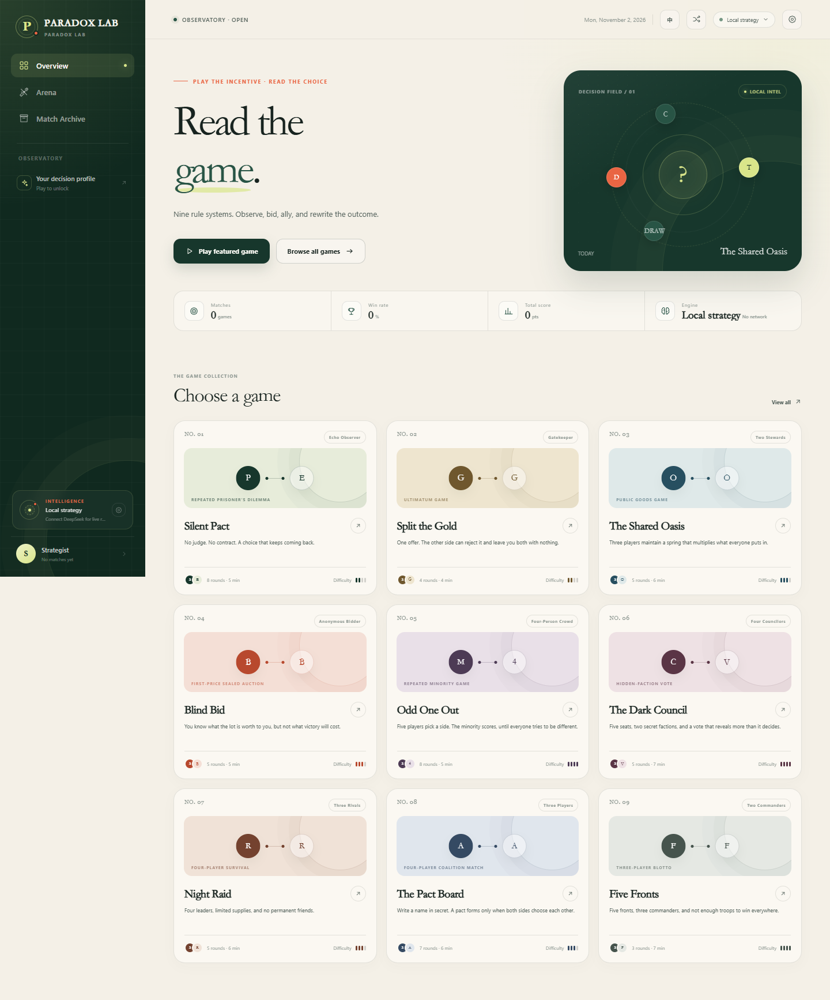
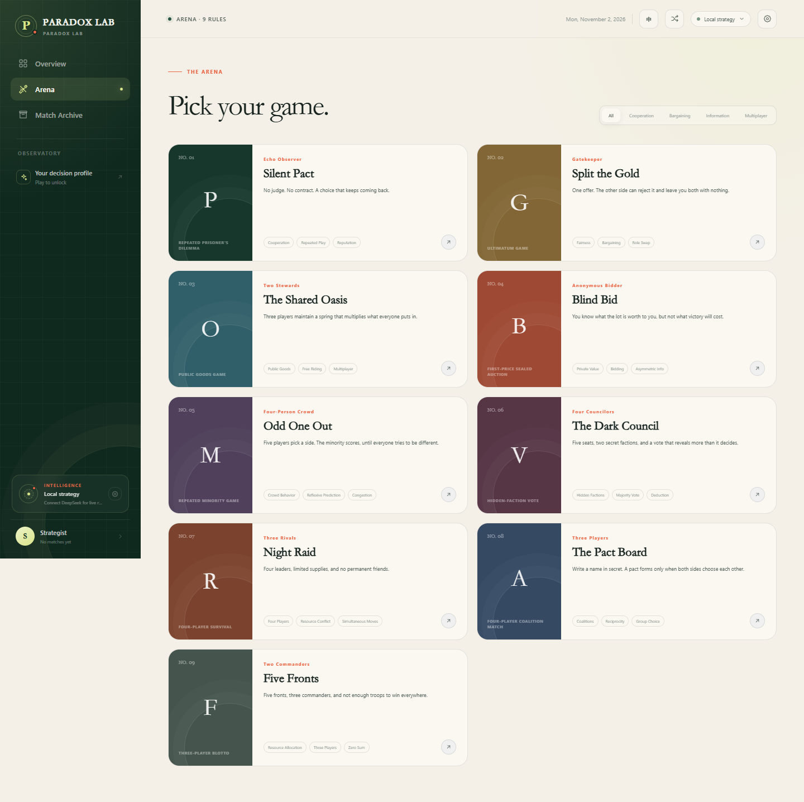
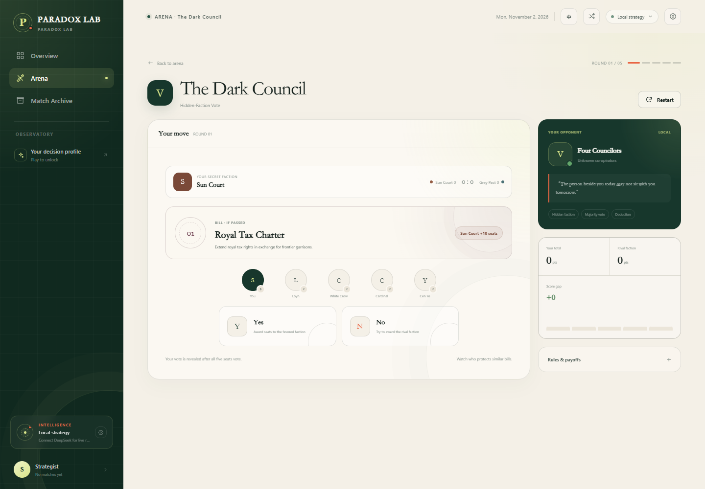
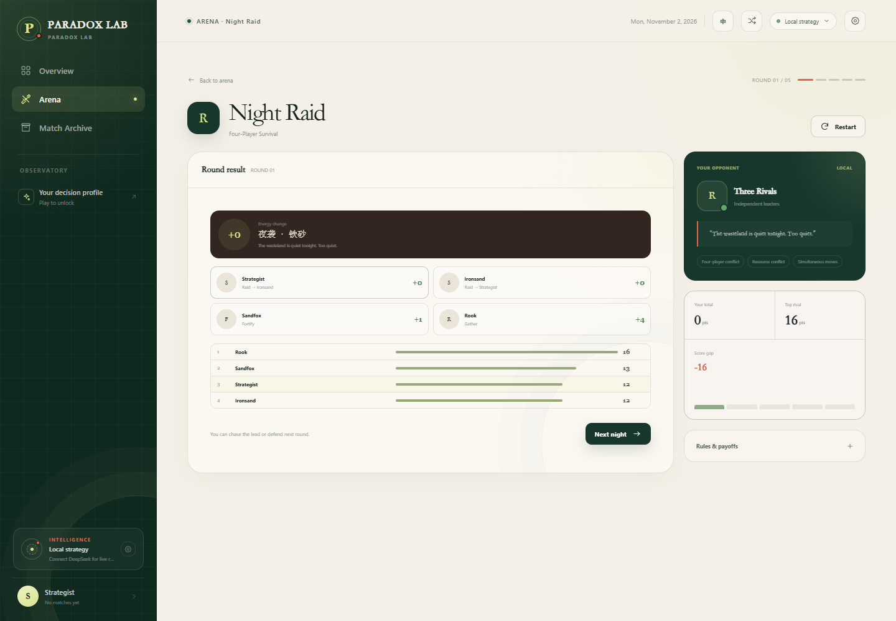
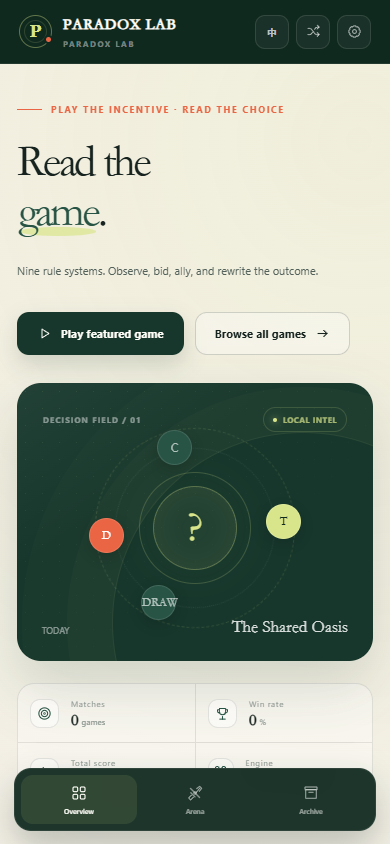

# Paradox Lab

**A bilingual collection of nine playable game-theory experiments.**

Paradox Lab turns cooperation, bargaining, public goods, auctions, hidden factions, resource conflict, coalition formation, and strategic allocation into focused interactive matches. Play entirely offline with adaptive local opponents, or connect a DeepSeek-compatible model for live character decisions.

[Open the app](http://127.0.0.1:4173) · [Report an issue](https://github.com/ZhuangHT-1201/paradox-lab/issues)



## Highlights

- **Nine distinct games** with separate rules, payoff structures, and AI strategies.
- **Single-click language switch** between Chinese and English. The current match and round are preserved.
- **DeepSeek integration** through a local server proxy. API keys never enter the frontend bundle.
- **Local strategy fallback** for every game when no API key is configured.
- **Real-time multiplayer-style systems**: hidden factions, simultaneous moves, forced coalition matching, and multi-front resource allocation.
- **Persistent match archive** and a four-axis decision profile stored locally.
- **Responsive, dependency-free frontend** with no build step.

## Screenshots

| Arena | Hidden-faction vote |
| --- | --- |
|  |  |

| Four-player survival | Mobile |
| --- | --- |
|  |  |

## Games

| # | Game | Players | Core mechanic |
| --- | --- | --- | --- |
| 01 | **Silent Pact** | 1v1 | Repeated Prisoner's Dilemma with memory and reciprocity |
| 02 | **Split the Gold** | 1v1 | Ultimatum bargaining with alternating proposer roles |
| 03 | **The Shared Oasis** | 3 | Public-goods investment, free riding, and adaptive stewards |
| 04 | **Blind Bid** | 1v1 | First-price sealed auction with private valuations |
| 05 | **Odd One Out** | 5 | Repeated minority game with reflexive crowd prediction |
| 06 | **The Dark Council** | 5 | Hidden factions, public votes, and seat control |
| 07 | **Night Raid** | 4 | Simultaneous gather, raid, and fortify decisions |
| 08 | **The Pact Board** | 4 | Secret coalition matching with mutual consent |
| 09 | **Five Fronts** | 3 | Three-player Colonel Blotto across five valued fronts |

## Quick Start

Requirements: Node.js 18 or newer.

```bash
npm start
```

Open [http://127.0.0.1:4173](http://127.0.0.1:4173).

No install step is required. The project has no production npm dependencies.

## Language Switching

Use the `EN` / `中` control in the header, or press `Alt+L`. The interface language is stored in the browser. Switching languages during a match does not reset the game.

Additional shortcuts:

- `Alt+R` starts a random game.
- `Enter` advances after a round when the main page has focus.
- `Esc` closes an open dialog.

## DeepSeek Setup

Create `.env` in the project root:

```env
DEEPSEEK_API_KEY=sk-your-key-here
DEEPSEEK_MODEL=deepseek-chat
DEEPSEEK_BASE_URL=https://api.deepseek.com
```

Restart the server after changing `.env`.

You can also enter a temporary key from **AI Settings** in the app. Temporary keys are stored in the current tab's `sessionStorage`, sent only to the local proxy, and never written into the repository.

Local opponents are always available and require no network connection. The game automatically falls back to them when the model is unavailable, invalid, or times out.

## Privacy

Profiles and match archives stay in browser localStorage. In DeepSeek mode, the active game state and recent relevant history are sent to the configured model endpoint to produce an opponent decision. Full match archives are not uploaded.

## Project Structure

```text
.
├── public/
│   ├── index.html
│   ├── styles.css
│   ├── app.js
│   ├── i18n.js
│   └── favicon.svg
├── docs/screenshots/
├── server.js
├── package.json
├── .env.example
└── README.md
```

The server uses only Node.js built-ins. It serves the static frontend and exposes a small `/api/ai` proxy for DeepSeek-compatible Chat Completions endpoints.

## Contributing

Issues and pull requests are welcome. For larger gameplay changes, describe the rule set, payoff table, and expected player interaction before implementation.

Before opening a pull request:

1. Run `node --check server.js`.
2. Run `node --check public/app.js` and `node --check public/i18n.js`.
3. Test both languages on desktop and mobile.
4. Confirm every modified game can reach its final result screen without runtime errors.

## License

[MIT](LICENSE) © 2026 Huiteng Zhuang
